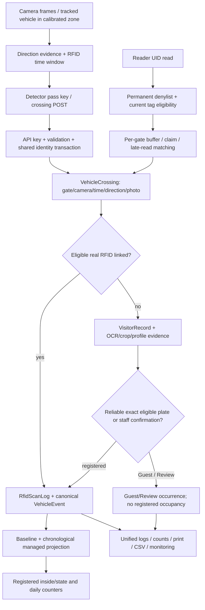
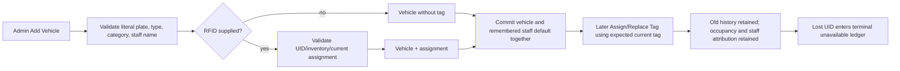
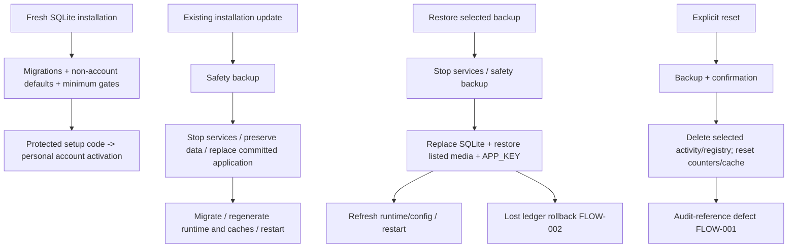

# PHILCST Vehicle Monitoring — current system-flow review

Review date: **2026-11-03, Asia/Manila**. Review-only; Registration Phase 6 remains **paused**.

The current working tree contains Registration Phases 1–5 and the targeted literal-plate/canonical-event repair. Fresh isolated verification passed: **571 Laravel tests / 5,431 assertions; 171 Python tests; 15 JavaScript tests; 572 Chrome assertions across 11 suites; production asset build**. Those results do not establish production readiness. Additional isolated scenarios reproduced defects in reset reference safety, restore/lost-UID permanence, detector delivery recovery, cross-gate event-key validation, date-based rankings, historical diagnostics, and long plate histories.

Only this document was added to the original workspace. No application fixes, live migrations, resets, seeds, data repairs, dependency installations, device connections, network discovery, deployments, publications, commits, or pushes were performed. Fixture initialization and destructive scenarios described below ran exclusively in private test copies, databases, storage and configuration. No real account credentials or private incident records are reproduced here.

## A. Current implementation and deployment state

### Evidence and scope

Inspected `routes/web.php`, `routes/api.php`, `routes/console.php`, bootstrap/middleware, navigation, principal controllers/services/models/requests, relevant views/JavaScript, detector HTTP/pass processing, operational commands, Windows packaging/install/update/restore scripts, tests, README, DEPLOYMENT, ACCOUNT-SECURITY, Registration Phase 1–5 reports and the literal-plate regression report. Previous reports were treated as claims and checked against source and executable fixtures. No applicable `AGENTS.md` was found in the project or its ancestors.

References below are repository-relative `file:line` locations in this working tree. Earlier UI, security and detector batches also use “Phase 6”; those names do **not** mean the paused **Registration Phase 6 snapshot expansion** is implemented.

| Area | Established current state | Evidence / limit |
| --- | --- | --- |
| Web application | Laravel 12, PHP requirement `^8.2`; Blade, local JavaScript/CSS, Vite 7, Tailwind 4; session authentication | `composer.json:7`, `package.json`; inspected local PHP is 8.5.3. Dependency lockfiles and installed packages were reused, not changed. |
| Local database | SQLite; original database inspected using a read-only SQLite connection, without bootstrapping the live Laravel app | Configuration category only was recorded. No `.env` values, account rows or raw payloads were printed. |
| Other database support | Laravel configuration includes MySQL and other standard drivers; identity/gate mutexes use database transactions and an initial singleton-row write | Windows automatic backup/restore is SQLite-specific. This review executed SQLite, not MySQL. Do not infer full cross-driver operational support from configuration alone. |
| Migration state | **70 definitions; 70 applied; 0 pending; 0 applied names absent from source** in the inspected local installation | Read-only comparison of migration filenames and migration ledger. No live Artisan migration command ran. |
| Background processing | Python detector/OCR/tracking, Python device service/UHF adapters, go2rtc live video; Laravel scheduler/runtime launchers | Runtime file exports carry gate/calibration/settings/device configuration. Runtime status files and caches are distinct from business events. |
| Intended Windows deployment | Caddy, four php-cgi backends, managed Python detector/device/go2rtc processes, NSSM/service scripts and scheduled tasks | `build/windows/templates/Caddyfile.template`, `deploy/windows/install.ps1`. Actual Windows installation and service state were not accessed. |
| Entrypoints | Browser pages under web/session middleware; `/api/v1/integration/*` for keyed adapters; CLI commands and scheduled runtime supervision | `routes/web.php:36`, `routes/api.php:38`, `routes/console.php:27`. Integration authentication is implemented in controllers through a shared trait. |
| Working tree versus release | HEAD is `9e4a210`; **94 pre-existing working-tree entries**, with no staged diff at review start | The release builder archives **HEAD**, not the working tree. `CanonicalMovementEventService.php` exists locally but is absent from HEAD. Current tests therefore do not certify a ZIP built from this HEAD. See FLOW-010. |
| Available artifacts | No `build/windows/dist` directory was present | No release ZIP/installer or GitHub release was downloaded, built, inspected or modified in this review. Remote/deployed source equivalence is unverified. |
| Development versus deployment | Local debug mode is enabled; no cached Laravel config was present | This is a development observation, not a finding that Windows is running debug mode. Windows runtime/API keys, installed schema and deployed assets need separate verification. |
| Historical integrity | Current read-only `PRAGMA foreign_key_check` returned **two violations**: one `direction_corrections → vehicle_crossings`, one `direction_corrections → visitor_records` | Does not identify which of the previously reported four references these represent, or explain the changed aggregate. No identities were guessed, repaired or deleted. See G. |

Relevant existing additive migrations:

- `2026_10_30_000001_archive_gates_and_ensure_minimum.php`: gate archival and gate-count mutex; missing gates are added inactive/unconfigured.
- `2026_10_30_000002_account_provisioning.php`: provisioning/account security state and transition policy.
- `2026_11_02_000001_add_registered_by_to_vehicles.php`: nullable historical staff attribution, required by new-registration application validation.
- `2026_11_03_000001_record_plate_classification.php`: persisted occurrence classification and shared plate-processing mutex.
- `2026_11_03_000002_plate_movements_and_unavailable_tags.php`: canonical movement linkage, managed occupancy baseline and permanent UID denylist.

Registration Phases 4/5 and the literal-plate repair add no new schema migration. No migration was created or applied during this review.

### Windows release/install/update contract

`build/windows/build-release.ps1:113` exports committed source, checks for installation data accidentally included in the export, installs production Composer packages into staging, bundles pinned/checksummed runtimes and local model files, and writes build metadata. The workflow `.github/workflows/windows-kit.yml` builds on Windows and invokes an installer smoke check; it does not explicitly run the full Laravel/Python/JavaScript/browser suites reproduced here. No remote workflow result was verified.

On a genuinely fresh installation, `deploy/windows/install.ps1:178` seeds gates/camera/ROI/default settings only. It restricts the setup directory ACL **before** issuing an expiring first-admin code. No usable account password is seeded. Existing installations run migrations without reseeding accounts or reinitializing completed setup. Installer setup-code initialization/replacement is explicit for interrupted installation cases. A stale `InstallSeeder` comment still describes a random-password workflow; executable provisioning uses code activation, as documented in ACCOUNT-SECURITY.

The updater backs up, stops services, swaps application/runtime files while preserving `.env`, database and storage, invokes installation setup/migrations/cache refresh, and restarts services. Its failure path attempts application/runtime and database rollback. The restore wrapper stops services, invokes backup restore, refreshes configuration/runtime files and restarts; unlike the update/install path, it does not run migrations. Cross-version restore compatibility therefore needs explicit verification before restoring an old-schema backup into newer code. None of these workflows was executed against Windows or an installation here.

## B. Existing functionality matrix

Roles: **A** = active admin with current password policy; **G** = active guard with current password policy; **I** = authorized integration client; **L** = local authorized operator/CLI. “Fixture” means isolated automated verification, not hardware verification.

| Feature | Role | Entry point | Main implementation | Actual behavior | Verification |
| --- | --- | --- | --- | --- | --- |
| First-admin provisioning | L, unauthenticated intended recipient | `system:first-admin`, `/setup` GET/POST | `AccountSecurityService:39`, AccountController, CreateFirstAdmin | Explicit initialization; hashed expiring code, bounded attempts; personal password; completed setup cannot reopen | Source, migration/security/release-boundary and process-concurrency fixtures |
| Individual activation | A creates; recipient activates | `/accounts`, `/activate`, replacement activation POST | `AccountSecurityService:101` | Pending account cannot sign in; one-time code response; activation cannot change assigned identity/role | Source and fixtures |
| Login/password/logout | Active accounts; restricted legacy session for password/logout | `/login`, `/account/password`, `/logout` | LoginController, EnsureAccountReady, PersonalPassword | Session regeneration/version checks; legacy personal-password transition; role/status change invalidates sessions | Laravel and Chrome fixtures |
| Account management | A | `/accounts`, PATCH `/accounts/{user}` | AccountController, AccountSecurityService | Admin/guard creation and role/status changes; last active admin protected; no account-delete endpoint | Laravel security fixtures |
| Dashboard | A | `/admin`, `/dashboard` redirect, `/admin/live-state` | `DashboardController:103`, MovementCount/Rfid/Occupancy/Presence services | Registered inside, movement periods/hourly chart, attention, registered/Guest rankings, camera health | Fixtures; date/diagnostic limitations below |
| Gate Monitor | A/G | `/gates`, `/gates/state` | GateMonitorController, RealtimeLogController | Active retained gates; live feed, latest results and recent logs; kiosk links | Source, page/browser and API fixtures; no live video |
| Gate kiosk / station read | A/G | `/gates/{location}/kiosk`, `/station/{location}/state`, RFID POST | StationController, RfidIngestService | Per-gate status and reads through shared ingest; old entrance/exit URLs supported | Fixtures; no keyboard wedge or reader hardware |
| Vehicle registry | A | `/registry?tab=vehicles`, `/vehicle-registry` POST/PUT, detail drawer | StoreVehicleRegistrationRequest, VehicleRegistryService, `registry.js` | Required plate/type/category/staff attribution; optional owner/RFID; edit/status/lookup/tag assignment; no ordinary vehicle deletion route | Laravel and Chrome validation/staff/type/optional-RFID suites |
| RFID inventory | A | `/registry?tab=tags`, tag lookup/status/replacement endpoints | VehicleRegistryService, RfidTag | Available/assigned/disabled/lost inventory; UID uniqueness and permanent unavailable enforcement; stale replacement rejected | Laravel, concurrency and Chrome fixtures |
| Guest records/manual entry | A/G | `/visitors`, `/visitors/records`; `/guests` redirect | VisitorController, VisitorRecordService | Records, profiles and Review; manual known IN/OUT, optional plate/type/photo/note; readable Guest does not imply registered occupancy | Laravel and Chrome fixtures |
| Review/plate correction | A/G | PATCH record plate/review/dismiss/type/direction | VisitorReviewService, VisitorRecordService, DirectionCorrectionService | Confirm/correct/pick suggestion/no plate/set name/dismiss/set previously UNKNOWN direction; audits; canonical reconciliation | Literal-repair, optional-RFID, type and browser fixtures |
| Plate profiles/history | A/G; merge A only | `/visitors/plates/{profile}`, note PATCH, merge POST | PlateProfile, VisitorRecordService, VisitorPresenceService | Shared plate profile, note/name, aliases, rankings, trips; merged profile redirects to target | Fixtures and source; FLOW-009 affects trips beyond 100 passes |
| All Activity Logs | A | `/logs?tab=events` plus JSON Accept header | VehicleEventController | Unified canonical events, unrepresented Guest/Review evidence and uncorrelated RFID rows; filters/details/CSV/print | Laravel, browser and isolated cross-output fixture |
| RFID scan history | A | `/logs?tab=scans` | RfidScanController, RfidService | Actual saved scans; search/gate/verification/fusion filters; 12 rows/page; private payload evidence download | Laravel/browser fixtures; clock semantics below |
| Alerts | A | `/logs?tab=alerts` | AlertController, AlertSummaryService | Saved anomalous scans plus attention summaries; ordinary camera Guest traffic is not automatically an anomaly | Source and fixtures; counts are scoped differently from list filters |
| Manual/legacy event handling | A | `/vehicle-events/create`, POST, detail, complete, direction | EventService, VehicleEventController | Manual event path and pending-details completion remain; old Guest/pass history retained for compatibility | Existing event/completion fixtures |
| Reports/exports | A | `/logs/print`, `/vehicle-events/export/csv`, legacy `/reports*` | VehicleEventController | Browser print/Save as PDF; unified CSV; single-record CSV; optional report images; no separate server PDF/XLSX generator discovered | Source, fixtures and private streamed CSV |
| Gate management | A | Settings Gates, POST/DELETE `/settings/gates*`, PUT `/settings` | SettingsController, GateManagementService | Rename/activate/create/archive; at least two retained gates, inactive counts; stable IDs/codes; General redirects | Gate/history/minimum/process-concurrency and browser fixtures |
| Devices | A/I | Settings device scan/identify/find/assign/unassign; integration devices POST | DeviceController, DeviceRegistryService, Python device service | Discovery/identity uncertainty; assignments; hide/unhide/delete with history labels; automatic/manual camera sources | Source; mocked discovery/encoder/network fixtures; no scan or hardware contact |
| Camera/reader settings | A | Gate camera/reader actions; Advanced Manual setup/reader network | GateSetupService, ReaderNetworkService, DeviceDeletionService | Credentials/source tests, webcam/manual/automatic assignment; reader network read/apply and encoder optimize are real device actions | Source and mocked tests only |
| Calibration | A | `?tab=calibration`, PUT `/calibration`, heartbeat/debug | CalibrationController/Service, calibration editor | Normalized ROI, direction and movement settings, preview/debug and saved-state handling | PHP/JS/Chrome geometry/save fixtures; no physical alignment |
| Advanced diagnostics/timing | A | `?tab=status`, timing, plate-camera, metrics | SystemStatusController, PipelineReport, PlateReadabilityService | Runtime/code/connection/pipeline status; per-gate timing; readability heuristics | Fixtures/source; no live throughput measurements |
| Test Scan | A | `?tab=test-scan`, `/rfid-scans/simulate` POST | `RfidService:31`, RfidIngestService::preview | **Preview only**, not a saved business scan or movement; respects simulation setting | Source and simulation fixtures |
| Live media/runtime frames | A/G, status A | `/camera/*`, `/live/*`, Windows `/detector/*` proxy | CameraFileController, LiveViewController, Caddy forward auth | Signed-in frames/WebRTC/HLS/proxy; status sanitization; separate historical public media issue | Auth/mocked stream fixtures; no real streams |
| Backups/restore | L | `backup:run`, `backup:restore`, Windows wrappers/tasks | BackupService, SystemResetService::folders | SQLite consistent DB copy plus listed media/export folders and APP_KEY; local ZIP, safety backup before normal restore | Laravel and private restore fixture; FLOW-002 |
| Activity/full reset | A activity UI; L CLI levels/devices | `/settings/system/reset-activity`, `system:reset` | SystemResetService, SettingsController | Dated backup/confirmation; activity cleanup resets occupancy/counters; full also clears registry; optional devices cleanup | Existing tests plus new isolated defect reproduction FLOW-001 |
| Maintenance/audit utilities | L | `visitors:cleanup`, `rfid:cleanup-unmatched`, `rfid:lost-conflicts`, `detection:accuracy`, `gates:list` | `app/Console/Commands/*` | Mutating cleanup commands have dry-run/backup conventions; lost-conflicts reports without repair; accuracy is a diagnostic proxy | Source; existing fixtures. Not run on live data |
| Runtime supervision/tools | L/scheduler | detector/go2rtc/devices start; finalize pending; device listen/find/rawdump; test-video; runtime:fetch | `routes/console.php`, runtime services, PythonLauncher | Every-minute runtime supervision; pending legacy scan finalization; explicit troubleshooting/video/download tools | Source/fixtures; no downloads, real tools or service changes executed |

Unavailable/deferred functionality: MFA and password recovery are not implemented in this provisioning batch. No active Guest Pass issuance UI was found; legacy pass models/fields/history remain for compatibility. `/reports`, `/manual-review`, old station/registry/scan/calibration URLs are redirects, not additional independent modules. Event-details `href="#"` controls are populated by JavaScript when a row opens; their presence alone is not a dead route. Offline camera/image placeholders and `hardware_placeholder` source codes must not be confused with evidence of simulated hardware—the latter is a retained machine source value used by the real reader ingest path.

## C. End-to-end flows

### C1. One physical pass and its related evidence

This is an **intended logical one-occurrence contract**, not a hardware claim that tracking always separates every vehicle correctly. Identity/count deduplication depends on occurrence keys and authoritative relationships, not plate similarity. A physical pass whose HTTP delivery fails can be lost (FLOW-003); an incorrectly reused key can contaminate another occurrence (FLOW-004).

1. **Trigger and direction.** The detector tracks a vehicle in the calibrated zone, opens an RFID observation window and estimates toward/away movement using the saved gate direction. It records after readiness/window expiry or departure/loss; a stationary vehicle is not recorded. Known direction becomes IN/OUT; unresolved motion becomes UNKNOWN. Best-picture/type/OCR work can update the same key until departure (`detector_service.py:2198`, `:2522`).
2. **Validation and persistence.** Integration controllers authorize the shared API key, validate a retained/eligible gate, camera association, time, direction and upload constraints. `PlateProcessingLock` writes the singleton row before identity reads and runs a retried transaction. Crossing POST retries reuse `external_event_key` rather than insert a second crossing. This endpoint does not fully bind reused keys to incoming gate/camera context (FLOW-004).
3. **RFID path.** Eligible reads are buffered/claimed for a gate/time window. With a working camera, a read alone normally remains ephemeral; the crossing creates the business scan. Late reads can attach to an existing crossing. Real scan identity and its FK links remain distinct from a plate match. Registered RFID creates/reuses a canonical event; matched RFID may mean no VisitorRecord is created at all.
4. **Plate path.** Without a verified tag movement, a VisitorRecord holds direction, photo/crop, raw OCR, profile suggestions and persisted classification. A reliable exact active registration existing by occurrence time, or explicit staff confirmation, can create the managed canonical VehicleEvent. No synthetic RfidScanLog is created. Valid unmatched plates remain Guest; unreadable/ambiguous/ineligible/conflicting evidence stays Review.
5. **Projection and display.** Managed completed events are projected chronologically from a saved baseline. UNKNOWN never toggles occupancy. Lists/counts suppress redundant VisitorRecord/legacy Guest evidence when a completed canonical movement represents it. Review work can remain visible alongside an already verified movement without creating another movement.
6. **Failure/retry.** Database failures roll back relational/classification/audit/state changes within the transaction. Canonical conflicts on staff correction get a controlled message; the browser keeps input and cannot report success without `ok:true`. Filesystem uploads are not inherently rolled back with SQL; old/replaced files are not comprehensively garbage-collected. There is no durable detector outbox; only an optional better-picture departure update may incidentally resend a crossing. See FLOW-003 and the Phase 6 attachment gap.

### C2. Registration, remembered attribution and tag lifecycle

- All new-registration entry points use the shared service/request. Required staff attribution is descriptive text, independent of the signed-in account/actor. A successful transaction stores `vehicles.registered_by` and updates `system_settings.registration_staff_name`; failure/cancellation does not update either. Ordinary edits ignore attempts to rewrite attribution/default. Historical NULL attribution displays “Not recorded.”
- Owner is optional. Strict personal-name rules apply to new/changed values; unchanged pre-existing organization names remain accepted. This preserves the user's earlier compatibility decision without introducing an owner-type field.
- Blank RFID creates no dummy inventory record. Later assignment/replacement preserves the vehicle ID, registration, recorded staff, images, state and history. Shared locking and an expected-current-tag comparison reject stale replacement. Previous tag relationships remain; disabled/lost behavior is explicit rather than deleting old evidence.
- Losing a UID writes the permanent canonical deny ledger. Subsequent variants normalized by the existing UID contract are rejected before business scan/alert/event creation; stale buffers and legacy pending work recheck current eligibility. Replacing a lost tag does not make the old UID reusable. The explicit full-reset implementation preserves the ledger; **older-backup restore currently does not** (FLOW-002).

### C3. Corrections, late evidence and chronology

Trigger → signed-in admin/guard permission → server field validation → shared identity transaction → classification/profile/audit and canonical resolution → reconcile affected vehicles → refreshed Review/logs/counts.

- Plate correction preserves original OCR evidence. Learned/fuzzy matches are suggestions requiring staff review; they cannot silently substitute another literal plate.
- `CanonicalMovementEventService:15` resolves by VisitorRecord link, external key and authoritative crossing/scan links. It rejects multiple owners, incompatible key-only camera/gate/time/direction/origin, or an unmanaged historical registered event. A valid key-only Guest event is adopted rather than duplicated. An already linked VisitorRecord is trusted; that trust does not validate the incoming integration context (FLOW-004).
- Retraction/dismissal or correcting identity retracts the old managed effect and reconciles both affected vehicles. A delayed older IN cannot overwrite a later known OUT; UNKNOWN does not toggle. Existing unmanaged history is not globally replayed or guessed.
- Late real RFID reuses the plate event and its ID. Genuine RFID provenance is linked, not fabricated. Identity disagreement stays Review; no guessed transfer to the conflicting plate. State-anomaly suppression is limited to an already applied managed movement, not merely any adopted Guest event.
- Set Direction is the existing once-from-UNKNOWN workflow, with correction audit and synchronized crossing/event/record. There is no general arbitrary rewrite of every historical known direction. Type correction records its own audit and effective before/after provenance, without changing identity, direction or counts.
- Separate-process SQLite tests exercised competing plate/RFID, plate corrections, key-only adoption, tag claims/replacement and gate removal. They prove local serialization scenarios, not crash recovery or measured high-load capacity.

### C4. Camera-offline RFID fallback

Reader trigger → integration/session authorization → UID normalization and unavailable/assignment checks → per-gate cooldown and camera-health/grace/fallback rules → linked camera direction when available, otherwise eligible state-derived IN/OUT → genuine scan/canonical event → chronological projection.

With a healthy calibrated camera, an unclaimed read alone normally creates no movement; a previously stored legacy pending read is finalized to a camera match, scan-only, or eligible offline fallback. Finalization rechecks eligibility and processes bounded batches of 50. Missing/UNKNOWN direction remains distinct from state fallback. An older read cannot toggle newer occupancy. The correctness of real reader timestamps, offline detection/grace and physical direction remains hardware verification work.

### C5. Gate archive and history

Admin confirms gate-specific removal → retained-gate count checked under gate mutex → archive, deactivate and release assignments in the same transaction → clear per-gate buffer/live caches → export camera/device runtime configuration.

At two retained gates removal is rejected with “At least two gates are required.” Inactive gates count; archived gates do not. Gate IDs/codes are not renumbered/reused. Cameras, credentials/calibration and event/history relationships remain stored; underlying network devices are not deleted by gate removal. Operational lists/new-record selectors exclude archived gates. Normal historical filters offer retained gates including inactive ones; supported old archived bookmarks keep a read-only historical criterion with Change gate/Reset; all-gates history includes archived records. Historical labels generally resolve the gate's **current retained name**, including after rename; there is no universal frozen historical gate-name snapshot.

Runtime export happens after commit. If it fails, the service explicitly says archival succeeded but runtime refresh needs retry by saving Gates settings (`GateManagementService:72`). Actual device shutdown/config reload after archive was not observed; it is covered by configuration fixtures, not a hardware stop/release test.

### C6. Setup/update/backup/restore/reset consequences

Backups capture SQLite using `VACUUM INTO`, listed public evidence folders, private RFID payload exports, camera frames/snapshots, and APP_KEY. The database includes accounts, attribution/default, device credentials/settings, occupancy baselines and unavailable UIDs **as of backup time**. ZIPs hold both encrypted credential data and the key needed to decrypt it; they are not encrypted archives. They are installation-sensitive artifacts, not suitable release content. The backup is not a complete OS/service/runtime image, and a DB-consistent snapshot plus separately copied live files is not a transactionally consistent multi-file capture.

Restore replaces DB/WAL state and restores listed file entries; it does not merge newer security/UID state, reconcile all extra files, or verify/migrate schema to current code. Restoring an older complete application/DB intentionally rolls data backward; that clashes with an unconditional “permanent lost UID” promise unless there is a durable external ledger/explicit policy. Reset retains accounts/gates/calibration/configuration, resets activity/occupancy and optionally registry/devices, but currently leaves correction audits referencing erased/reused IDs (FLOW-001). No reset/cleanup/restore was run on installation data in this review.

## D. Data, identity and state map

| Entity / state | Identity and relationships | Contract / historical meaning |
| --- | --- | --- |
| `users`, `account_security_state`, `security_events`, sessions | Account IDs; activation/setup hashes, policy/session versions; actor/subject audit IDs | No universal admin password; pending/inactive/version-stale sessions cannot operate. MFA/recovery deferred. |
| `gates` | Stable ID and `code`; current display name; active flag separate from archive timestamp | Minimum counts non-archived rows, including inactive. Historical code resolver accepts archived rows where explicitly allowed. |
| `cameras`, ROIs/calibration, `network_devices`, `device_assignments` | Camera IDs and gate role; assignments join network device/role/station | Gate archive releases assignments, retains history/config objects. Explicit device deletion separately detaches device links and appends “(removed)” labels to historical evidence. |
| `vehicles` | Stable registration ID; literal plate, category/status, optional current tag, immutable ordinary-edit staff attribution | Current registry ownership/metadata is not a historical identity decision. `current_state` and counters are derived/cache-like state maintained by movement services. |
| `vehicle_rfid_tags`, `unavailable_rfid_uids` | Canonical UID, current status/vehicle relationship; unavailable ledger independent of reusable registry IDs | UID is distinct from plate; current assignment must be rechecked. Lost is terminal through app paths; restore caveat applies. |
| `vehicle_crossings` | Unique external key, camera/gate/time/direction; optional RFID link, tracking/device/type/photo metadata | Camera evidence occurrence, not necessarily a registered movement. |
| `visitor_records` | External key; optional crossing/profile/vehicle links; `seen_at`, source, plate/OCR/confidence/review/classification | Guest/Review and plate-identification evidence. Active/duplicate/dismissed status controls counting. Persisted decision supersedes inference from today's profile ownership. |
| `plate_profiles`, aliases | Literal plate key, merged target, current owner/vehicle, notes and aggregate visits | Current grouping and suggestions; merge history is explicit. Aliases/fuzzy matches are not exact registry proof. Registration can explicitly transfer a selected profile's history while retaining recorded occurrence classification. |
| `rfid_scan_logs` | Genuine saved read, scan time/location/tag/vehicle, fusion result, crossing and correlated event IDs, private payload reference | Plate-only events must not manufacture scans. Ephemeral buffered reads, lost reads and Test Scan previews need not create rows. |
| `vehicle_events` | Unique external key when supplied; unique nullable `visitor_record_id`; scan/camera/vehicle/session links; event time/type/status/origin | Canonical movement or legacy/manual business event. Managed flag controls chronological projection; pending-details/hidden copies excluded in operational report paths. |
| `vehicle_occupancy_baselines` | Vehicle ID and pre-managed state/counters/time | Anchor protects pre-existing state. Managed event order is occurrence time plus ID. No inferred bulk replay of unprocessed installation history. |
| `active_sessions` / matched entry-exit | Vehicle/event links, open/closed state | Related stay/session bookkeeping; not a separate visitor addition to official registered inside total. |
| Review/type/direction audits | Record/crossing/event/profile/user IDs plus before/after values | Preserve who changed evidence; reset currently breaks referential safety and can retarget IDs. |
| Legacy Guest observation/pass and receive logs | Optional keys/scan/camera/history links; converted/archived flags | Compatibility history; converted/mirrored copies suppressed, old pass fields do not imply active pass issuance. |
| Runtime files/cache/buffer | Per-gate camera/device config, status/frame/heartbeat, RFID claims, go2rtc settings | Operational state; not independent proof of a persisted occurrence. Array cache used in most fixtures differs from production persistent cache. |
| Images/crops and payload exports | Files referenced by paths from crossings/records/events/scans | Metadata/FKs can survive archival; referenced file existence and authorized access are separate properties. Historical image URLs are currently public (FLOW-007). |

**ID rules:** Plate keys discard only accepted separators and preserve alphanumeric order. `395ISX` and `ISX395` remain different keys everywhere checked. UI display may group a letter-first plate with spaces; that is presentation, not reordering. Scan UID normalization preserves meaningful punctuation and leading zeroes. External keys identify occurrences, not vehicles; vehicle identity can be corrected while retaining occurrence/event IDs. SQL uniqueness plus locking protects duplicate inserts, but does not itself prove compatible incoming context.

## E. Reports, counts, exports and verified calculations

### E1. Inventory and calculation rules

| Output / entry point | Sources and inclusion rules | Time, filters, order / grouping | Relationship to other outputs |
| --- | --- | --- | --- |
| Dashboard traffic, period/category/gate totals and hourly chart; `/admin`, live-state | `MovementCountService:63`: non-pending registered/manual canonical movement events; active unrepresented VisitorRecords; eligible unconverted legacy camera/manual Guest observations. Mirrored RFID/Guest copies, duplicate/dismissed visitor rows excluded | `event_time`, `seen_at`, `observed_at`; local half-open periods. Hourly Today has hourly grouping. UNKNOWN increments unknown, not IN/OUT/category/gate IN/OUT | Traffic includes Guest and Review known-direction passes, not just registered vehicles or actual tag reads. Review gets its own dynamically added category, not Unregistered Guest. |
| Official Inside Campus and registered category split | `VehicleOccupancyService:24`: active registered current state INSIDE; categories normalized | Current state, no selected historical date filter | Not IN minus OUT over the selected period: baselines, vehicles already inside, repeated same-direction evidence and UNKNOWN matter. Guest “possibly inside” remains separate. |
| Registered daily entries/exits | `RfidService:196`: vehicle projected counters whose `daily_count_date` is local today | Registered category and recorded projected date; not scan count | Includes eligible plate-only movements despite service name. Does not count Guests. Does not invent pre-baseline totals. |
| Registered ranking | `DashboardController:166`: registered vehicles, event counts plus unrepresented eligible plate rows | Per-vehicle all-time and Today; Today event branch uses `event_time OR created_at`; sort/ranking fields in controller | FLOW-005: late old event can count as Today ranking but not Today traffic/logs. Not a genuine-RFID leaderboard. |
| Guest/profile ranking and profiles | `VisitorRecordService:562`, `:633`, VisitorController | Active qualifying profile records; entries/visits and first/last seen; current unregistered profile ownership; top Dashboard list and paginated profile list | Grouping follows explicit profile merge/current ownership, while occurrence classification is persisted. Ranking is not identical to raw record count. |
| Guest “possibly inside” / profile trips | `VisitorPresenceService:25`, `:67` | Active IN/OUT; today estimate groups last record by profile; unplated IN separately; trips pair same-day IN→next OUT, across gates | Estimate only; no automatic addition to official occupancy. Trips currently select oldest 100 passes (FLOW-009). |
| Activity Logs events HTML/JSON | `VehicleEventController:568`: canonical events without hidden copies/non-pending; eligible legacy Guest rows; uncorrelated scan-only rows; active unrepresented Guest/Review rows | Plate, owner, gate (including historical bookmark), event/match/category/log type, date/period. Separate date field per source. Combined result sorted by `sort_time` descending; **15/page**, filtered total/summary before pagination | One visible canonical movement per represented occurrence. A scan-only row is evidence, not IN/OUT. Filters involving current related vehicle metadata can differ from captured historical fields. |
| Activity summary | `VehicleEventController:783` | Count visible filtered rows; ENTRY/EXIT counts; `is_guest` count; literal RFID-only event type count | The RFID-only summary excludes real RFID reads already represented by movement events. It is not “all scans.” |
| CSV `/vehicle-events/export/csv` | Same unified payload/filter pipeline, 14 columns including type/source/category/gate/state/time/type provenance | Row action: one resolved record; toolbar `all=1`: all filtered rows; direct default: page of **10**, not HTML's 15. No special full snapshot export | Human labels changed to Guest; machine codes/column order retained. Toolbar expressly requests all rows. Direct default page size is an existing contract and must be explicit to API callers. |
| Print/Save as PDF `/logs/print` | Same unified filtered data; current/today/week/month/year/all presets, optional images | Ascending occurrence time; all filtered rows, no page limit; by category and gate summaries include other encountered labels and total; print date and preparer | Browser print/PDF, not server-rendered binary PDF. Snapshot option only shows images already attached; no new capture. Legacy `/reports` redirects. |
| Event detail / single-record CSV | VehicleEventController detail and unified record resolver | Event ID or explicitly allowed record type/ID | Historical type/plate fields retained where captured; owner details may be current registry relationship. |
| RFID Scans tab | `RfidService:105`: actual saved RfidScanLog rows; status/fusion/unknown-tag compatibility filters | Search UID/current vehicle plate-owner, historical gate, verification; scan_time descending; **12/page**; no date filter in current scan-history UI | Real evidence only; buffered/lost/preview reads are absent by design. Actual scans can be more/fewer than camera movements. |
| RFID stats / Test Scan attention | `RfidService:182` | Today scan counters use `scan_time OR created_at`; simulated source counter separate; inventory/state counters unrestricted by date | Same temporal mismatch risk as FLOW-005; “verified” is verification status, not proof of resolved movement. Preview itself saves nothing. |
| Alerts tab / shared attention counts | AlertController; AlertSummaryService | List: anomalous saved scans, optional unknown-tag/type/search, latest scan time then ID, 15/page. Summary is separately cached/scoped; recent items bounded | Summary is not necessarily filtered list total. Normal Guest movement is not an anomaly. Lost reads are ignored, so old comments describing future lost alerts are stale. |
| Gate/kiosk/realtime feeds | RealtimeLogController; gate state endpoints | Recent bounded merged source rows; gate filtering; creation/time ordering and final `sort_time`; feed limits capped at 50; Gate Monitor asks 8 per gate | Recent-result feeds, not date reports; limited prefetch means not appropriate as an exhaustive export. Pending and mirrored rows suppressed by respective builders. |
| Registry/inventory summaries | VehicleRegistryController, RfidService, VehicleOccupancyService | Current vehicles/category/status/state and inventory available/assigned/lost/disabled; separate list criteria | Current stock/state, not historical traffic. Unassigned inventory tag is not a vehicle. |
| Plate readability Advanced | `PlateReadabilityService:43` | Last 50 camera VisitorRecords per operational gate; counts effective read/corrected/unreadable, measured crop width/sharpness medians and heuristic hints | Includes staff-corrected reads; not raw OCR ground-truth accuracy. Dismissal/duplication exclusions are not equivalent to traffic reports. |
| Detector counting/type diagnostics | `DetectionAccuracyService:30`, `:99`; `detection:accuracy` CLI | Inclusive `whereBetween` time ranges; crossings by crossed_at; camera records seen_at; RFID fusion buckets; corrected types by correction created_at; coarse Car/Motorcycle/Truck-Bus families | Diagnostic proxy, not electric/subtype recognition or independent physical ground truth. Current-registry type lookup changes historical score (FLOW-006). |
| System health/pipeline/encoder diagnostics | `/system/health`, Settings status/metrics, device endpoints | Status files, timing, service freshness/code hash, queue/frame/network/camera configuration; some actions contact hardware | Not business event truth or measured detection accuracy. Fixture connectivity is mocked. |
| RFID payload evidence | `/evidence/rfid-scans/{id}/payload` | Admin-authorized private stored JSON file referenced by a saved scan | Downloadable evidence, not another movement/export count; secrets/private payloads were not inspected in full or published here. |
| CLI audit/cleanup/backups | gates:list JSON, lost-conflicts, cleanup export, backup ZIP | Command-specific data: lost-conflicts read-only; cleanup outputs and backups local and potentially sensitive | No general XLSX, scheduled emailed report or cloud reporting found. Cleanup exports are maintenance evidence, not public report endpoints. |

Time contract: `PhilippineTime:36` defines Asia/Manila business periods: Today `[00:00,next 00:00)`, Monday-based week, calendar month/year. Occurrence fields are compared using local boundaries; `created_at` uses configured application/storage timezone conversion. Explicit report date_to includes the whole selected day by adding one day to the exclusive endpoint. Accuracy diagnostics use inclusive endpoints instead, so adjacent diagnostic ranges can double-count a boundary. Windows/Python clock synchronization and mixed legacy timestamp conventions were not measured. Existing fixtures use controlled clocks; they do not certify every historical installation timestamp.

### E2. Fresh isolated calculations

All identifiers below are synthetic. Expected totals were specified from the fixture, then independently read through the listed services/controllers/streamed CSV; no installation records were changed.

| Scenario | Expected | Actual | Assessment |
| --- | --- | --- | --- |
| A registration created before the test day; plate-confirmed IN 11:00, OUT 11:10, UNKNOWN 11:20; unmatched Guest IN 11:30; unreadable Review IN 11:40; dismissed false positive IN 11:50 | Five counted occurrences: IN 3, OUT 1, UNKNOWN 1; registered outside; 3 canonical registered events, 0 RFID rows; dismissed excluded | **IN 3 / OUT 1 / UNKNOWN 1; inside 0; 3 events; 0 scans; Activity JSON 5; print 5; streamed CSV 5 rows × 14 columns; Review category IN 1** | Agreement for occurrence totals across Dashboard movement service / API / print / CSV. Guest and Review retain separate categories. Does not claim all source/filter combinations exhaustively verified. |
| Registered backdated IN yesterday, processed today; registration existed before that pass | Inside 1; Today's occurrence-based traffic/logs/print 0; consistent ranking definition needed | **Inside 1; Today traffic IN 0; registered daily entries 0; Activity Today 0; print Today 0; ranking Today 1** | Reproduced temporal disagreement FLOW-005. |
| Registered valid RFID + camera crossing with submitted image | One genuine scan-backed movement; crossing evidence retained; photo propagation considered separately | HTTP **201**, one IN, genuine scan link, crossing image present, **event image absent**, no VisitorRecord | Canonical count works; snapshot propagation is the planned Phase 6 gap, not a Phase 5 regression. |
| Same OCR external key originally Gate 1, later request says Gate 2 and another registered plate | Controlled conflict without changing the Gate 1 identity | HTTP **200**; stored gate remains Gate 1; identity changes to second registration; still one event | FLOW-004: uniqueness is preserved but occurrence identity is contaminated. |
| One registered type diagnostic crossing; registry type edited afterward | Historical captured diagnostic evidence stable, or explicitly current-state comparison labelled | Registered diagnostic score **100% → 0%** with no crossing change | FLOW-006. |
| Profile with 101 chronological active passes | Newest trip/pass available in “Newest first” recent trips | Latest pass omitted; newest returned pass is the preceding one, because oldest 100 selected | FLOW-009. |

Healthy late RFID/manual/OCR retry, delayed older correction, unknown direction, occupancy baseline, lost/replacement and archival/filter scenarios also passed in existing regression suites. The mixed-output fixture did not separately drive every synthetic row through Chrome; browser suites independently verified UI rendering/filter/export/menu behavior. This distinction matters when interpreting “agreement.”

## F. Decision tables and validation/permissions

### Identification and classification

| Evidence | Decision | Occupancy / RFID provenance |
| --- | --- | --- |
| Exact literal key; one eligible active registry vehicle created by seen_at; reliable supported OCR evidence | Registered, captured category | Managed plate occurrence; known direction sets state; no manufactured scan |
| Staff confirms that exact eligible plate | Registered, staff plate source | Same occurrence/event ID; audit and chronological reconcile |
| Reliable valid plate with no eligible exact match | Guest | Guest movement; no registered inside change |
| Unreadable/invalid/low confidence/fuzzy or learned suggestion/multiple matches/inactive matching registration | Review | No guessed registered effect; known camera direction can still count as a Review movement |
| Linked flagged RFID evidence | Review/restriction retained | Plate does not bypass disabled/unassigned/inactive restrictions |
| Genuine verified RFID and conflicting OCR plate | Verified RFID identity retained, disagreement exposed for Review | No second event/guessed identity transfer; explicit resolution needed |
| Registration added after the occurrence | Prior persisted Guest decision remains historical | Current profile ownership alone does not retrospectively establish eligibility |
| Lost UID, including stale buffered evidence | Ignored | No new business scan/event/receive-log/operator alert for that read; camera occurrence can continue |
| Unsupported legacy value unchanged during unrelated edit | Compatibility retention where validator allows it | No bulk identity normalization or history rewrite |

`VisitorRecordService:587` checks exact keys and registry created_at plus **current** active status. It does not maintain a complete historical registry-status timeline. Thus “event-time eligible” means registration existed then plus current eligibility checks at processing time, not proof that a full time-versioned status history was reconstructed. Current profile ownership and captured occurrence classification must remain separate in future changes.

### Direction and occupancy

| Input / context | State/count behavior |
| --- | --- |
| Managed completed IN | Sets inside at that point in chronological projection; contributes IN; repeated same-direction evidence may be flagged but must not be collapsed into an inferred OUT |
| Managed completed OUT | Sets outside at that point; contributes OUT |
| UNKNOWN | One unknown occurrence/Review direction item; no state toggle or invented IN |
| Delayed older correction | Reconcile sorted occurrence time/ID against baseline and newer managed events; do not overwrite newer state by request arrival order |
| Retract/dismiss/reidentify old plate | Remove old managed effect; reconcile old/new affected vehicles |
| Verified late RFID for completed managed plate event | Reuse event; attach genuine provenance; avoid applying the same state change twice |
| RFID-only allowed while camera offline | State-derived direction explicitly labelled; older evidence cannot toggle newer state |
| Pending details, duplicate/dismissed evidence | Excluded by relevant completed/active movement builders; scan-only remains evidence, not a vehicle movement |
| Pre-managed history | Preserve baseline; no automatic replay/backfill or invented pre-baseline counters |

### Tag states

| State | Assignment / use | Transitions |
| --- | --- | --- |
| Available | Can be assigned if no conflicting current link | Existing assignment rules under shared lock |
| Assigned, active vehicle/current tag | Eligible genuine identity | Disable, mark lost, replace according to UI/service rules |
| Disabled | Not an eligible active movement identity | Existing enable policy; old links/history retained |
| Lost / UID denylisted | Cannot enable, assign, rename UID into reuse, delete/recreate to bypass, or consume buffered reads | Terminal through application paths; full reset retains ledger; **restore rollback defect FLOW-002** |
| Unknown/unassigned/inactive vehicle | Existing buffer/review/anomaly handling, no guessed registered movement | Explicit admin registry/status work required |

### Physical vehicle type versus registration category

Category answers Faculty & Staff / Registered Guest / Unregistered Guest (stored compatibility codes remain `faculty_staff`, `registered_visitor`, `unregistered_visitor`). Type answers physical form. Neither a Bus class nor a registered tag proves an electric subtype.

| Type evidence | Effective type / source |
| --- | --- |
| Explicit staff type correction | Staff choice and correction audit; retained on late generic evidence |
| Explicit manual entry type | Manual source; not fabricated detector output |
| Eligible registered occurrence with captured registry type | Registry snapshot for that occurrence/identity |
| No higher-priority evidence, supported detector label | Actual broad class, with raw detector evidence retained |
| Unsupported/missing/tied automatic type | Unknown; no default Car, no geometric relabelling into an electric/subtype answer |
| Later registry edit | New occurrences may use new registry type; existing captured type stays stable in event/scan presentation |
| Unmarked historical type | Existing historical evidence/Unknown, not an invented retroactive registry snapshot |

Nineteen manual/registry labels are present in `VehicleType:18`, including electric labels and retained legacy Truck/Bus. Local model metadata was **re-read without inference or downloads**: YOLOv8n and YOLOv8s each expose 80 COCO names, with car/motorcycle/bus/truck; the plate model exposes only license_plate. Operational mapping resolves advertised names, not arbitrary hard-coded future model IDs. This does not verify road accuracy or electric/tricycle automatic recognition. Historical type display is protected by `VehicleTypeEvidenceService` and stored application evidence; the accuracy diagnostic still violates the same historical expectation (FLOW-006).

### Validation, permissions and UI behavior

- Web operational routes use session auth, account readiness and role middleware. Admin-only groups protect registry, settings, accounts, logs/reports, device/network actions and gate mutations. Guards can monitor and perform existing Guest/manual/Review work; profile merge is admin-only. This is enforced server-side, not only by hidden buttons. FormRequest `authorize(): true` is not itself a bypass because the routes enforce role middleware. Service methods are internal calls and do not universally take an actor/role.
- Integration controllers use constant-time comparison for a nonblank configured key. Keyless loopback is allowed only for non-production `offline_local` configuration with no key (`SettingsService:94`); production does not get that exception. Session log feeds require web authentication, with admin restriction for Guest/event administration feeds. API throttles exist; no device calls were made to validate network trust boundaries.
- New/changed owner names use Unicode personal-name rules, optional empty allowed, invalid supplied/space-only rejected; unchanged existing organization names are accepted. Required staff name reuses stricter registration rules and normalizes ordinary spaces. IME handling, inline validation and server rejection were exercised in Chrome and PHP fixtures.
- Plates allow literal letters/digits and supported separators; unsupported characters are rejected rather than stripped into another identity. PHP, Python and browser handling preserve order. New registry uniqueness is checked canonically; legacy unsupported unchanged identifiers can survive unrelated edits. Plate confidence uses API 0–1, while legacy/manual event confidence forms have their separate 0–100 contract; callers must use the correct endpoint schema.
- RFID is optional; supplied UID/inventory/current assignment is validated on the server. Models and service paths enforce permanent UID unavailability. No relaxation to the identity model is needed to support untagged vehicles.
- Automatic list filters debounce/replace results while retaining valid focus/form state, ignore stale responses, handle IME/history/reset, and do not silently broaden a rejected CSV/print query. Mounted registration forms are outside automatic result replacements. Browser checks exercised combined criteria, races/errors and row actions.
- Shared table row menus use native Popover or same-node body portal fallback, bounded to viewport, scroll-follow/close behavior, stale detached-row action blocking, keyboard/Escape/focus return. Phase 5 Chrome checks include short results/archived bookmarks/refresh and both menu paths. This is not an assistive-technology audit or actual Windows browser zoom test.
- The recent staff plate-correction failure path has controlled 409/500 messages and input retention even in debug-mode fixture conditions (`VisitorController:223`). That fix does not prove that every unrelated unexpected exception in a debug installation is sanitized. No global debug-response guarantee is made.

## G. Prior fixes and recent regression status

| Claim | Current assessment | Evidence / remaining limit |
| --- | --- | --- |
| Registration 1: required/remembered staff | **Present and verified** | Server/service transaction tests and 37 Chrome assertions; optional legacy attribution preserved |
| Registration 2: normalization/classification | **Present, with later literal-order repair superseding earlier assumptions** | PHP/JS/Python literal tests, exact eligibility and Review tests. Any old report text accepting transposition is obsolete. |
| Registration 3: optional RFID/canonical chronology/lost | **Present and verified in normal processing; maintenance exception found** | OptionalRfidMovement and process-concurrency tests pass; FLOW-002 disproves unconditional permanence through old backup restore |
| Registration 4: shared physical types/provenance | **Present and verified for normal event/scan display; diagnostic exception found** | Type suite/59 Chrome assertions/model metadata; FLOW-006 |
| Registration 5: archived filters/Guest labels/menus | **Present and verified** | 132 Chrome assertions plus server tests; stored/route machine contracts retained |
| `395ISX` became `ISX-395` | **Repair present and reverified** | `PlateNumber:10`, `public/js/plate-input.js`, Python normalization/voting; distinct-key/search/suggestion tests and 19 regression Chrome assertions. No original installation record was corrected here. |
| Duplicate `vehicle_events.external_event_key` on correction | **Targeted repair present and reverified** | Canonical resolver adopts only compatible key-only event; collision paths controlled/atomic; tests preserve event ID, original evidence, RFID provenance and one count under competing processes |
| Raw SQL/path shown in plate correction browser | **Targeted path repaired and reverified** | Controlled failure wrapper, browser refuses raw failure payload/success without `ok:true`, input remains, rollback assertions; unexpected failure test passes. Other debug-mode exception paths not exhaustively audited. |
| General Settings removed/minimum gates/history | **Present and verified** | Gates/Advanced tabs and legacy redirect; admin mutation tests; competing gate-removal processes retain two; archive/assignment/history fixtures |
| Four previously reported broken historical references | **Not mapped; current aggregate two violations observed** | Only original read-only FK check, no raw private IDs in this report. Reports lack enough identity evidence to establish which of the four persists/disappeared or why. Nothing repaired. |
| Registration Phase 6 snapshots | **Paused; partially existing capture is not completed expansion** | Detector submits available images for both paths; private RFID fixture has crossing image but no canonical event image. See K. |

Historical audit IDs: available earlier security-request text explicitly associates **AUDIT-001** with default admin credentials/provisioning. Its executable source problem is **resolved in the current working tree**: AdminUserSeeder is inert, DatabaseSeeder/InstallSeeder create no accounts, first-admin uses protected activation, and release-boundary/security tests pass. Packaged/deployed resolution remains unverified. Original definitions of **AUDIT-002, AUDIT-003 and AUDIT-004** were not found in available repository/request evidence; their status is **unverified/unmapped**, not “resolved” and not reassigned to new findings by guesswork. The FLOW IDs below are new review identifiers.

## H. Prioritized findings

“Confirmed” means source plus the reproduction described, or an explicit configuration fact; it does not imply the live installation was modified or attacked. Severity describes practical consequence, not an observed production incident.

### FLOW-001 — High — Confirmed: reset leaves correction audits orphaned and later retargeted

- **References:** `app/Services/SystemResetService.php:46`, `:161`, `:275`; `database/migrations/2026_10_14_000003_visitor_review.php`; DirectionCorrection/ReviewAction relationships.
- **Trigger/reproduction:** Private fixture created a corrected plate and direction, producing two ReviewActions and one DirectionCorrection. Activity reset retained all three audit rows while deleting their target history. FK check returned **six violations**. After a new occurrence reused IDs, the old review and direction references resolved to the new occurrence/crossing.
- **Expected versus actual:** Audit references must remain valid, deliberately detached, or archived with their original occurrence. Actual reset disables FK actions, omits `review_actions` and `direction_corrections` from its table plan, then restarts target IDs. `nullOnDelete` cannot protect rows while FK actions are disabled.
- **Impact/scope:** Existing audit/history integrity at reset time and misleading attribution of **future** records after ID reuse. A preserved row resolving to a new record is worse than a visibly missing relation. This reproduction does not establish the cause or identity of the live historical violations.
- **Fix direction/acceptance:** Decide retained-audit versus explicit cleanup policy; include every referencing table in a tested reset plan, detach preserved FKs before ID reuse or avoid reuse. Cover activity/full/device variants with post-reset FK checks and creation of new records proving old audits cannot retarget. Keep backups and existing user/gate/security/UID contracts. Any live historical repair requires a separately authorized record-specific audit.

### FLOW-002 — High — Confirmed: old backup restore revives a permanently lost UID

- **References:** `app/Services/BackupService.php:132`, `:139`; `app/Services/VehicleRegistryService.php:590`; `deploy/windows/restore.ps1`; `REGISTRATION-PHASE3.md:90`.
- **Trigger/reproduction:** Private assigned UID → backup → mark lost → restore that earlier backup. `isUnavailableUid` changed **true → false**, and the restored tag was **assigned**.
- **Expected versus actual:** “Lost is permanently unavailable” should survive supported maintenance or be explicitly qualified. Restore blindly replaces the entire DB, including the deny ledger, so newer lost decisions vanish. Safety backup helps reversal but does not enforce the contract.
- **Impact/scope:** Security/eligibility state and new reads/assignments after restore; restored current data re-enables a previously barred UID. Other account/session/security decisions also roll back with the DB and need an explicit restore policy.
- **Fix direction/acceptance:** Define restore semantics before implementation. On the same installation preserve/union the monotonic UID deny ledger across replacement and reapply terminal restrictions atomically; consider an independently backed-up installation ledger for recovery to a new PC. Test backups before loss, after loss, before the ledger migration, missing referenced tags, and repeat restore. The new-PC case cannot recover post-backup loss knowledge from that backup alone. Also verify schema-version compatibility; the restore wrapper currently does not migrate old schemas.

### FLOW-003 — High — Confirmed: failed detector delivery is counted locally and discarded without durable retry

- **References:** `school-vehicle-monitoring-detector/detector_service.py:2198`, `:2522`, `:2574`; `school-vehicle-monitoring-detector/laravel_client.py:237`.
- **Trigger/reproduction:** Private Python fixture drove a tracked vehicle through a zone and departure; fake client rejected crossing/Guest/plate delivery. Result: **one crossing delivery attempt, local passes_recorded=1, pending_windows=0, backend accepted=false**. Error text remained, but pending work was gone.
- **Expected versus actual:** A transient backend timeout should leave recoverable work or a clearly unrecorded state. Actual `record_pass` sets recorded/counter state before POST acknowledgement; the worker drops its window in `finally`. The HTTP client performs one POST. A sharper departure image can incidentally cause another submission, but is not a retry guarantee.
- **Impact/scope:** Lost **new events/evidence**, local/runtime versus persisted-count disagreement during backend outage/restart/congestion. No durable backpressure/outbox was found in this path.
- **Fix direction/acceptance:** Small durable per-install outbox keyed by occurrence, bounded backoff/capacity/observable failure, acknowledgement-aware counters and idempotent replay. Test outage through departure and detector restart, accepted-but-response-lost replay, ordering of crossing/plate/image updates, and no duplicates. Avoid opening real hardware in the tests.

### FLOW-004 — High — Confirmed: reused incoming external key is not bound to original gate/camera context

- **References:** `app/Http/Controllers/Api/CrossingIntegrationController.php:65`; `app/Services/VisitorRecordService.php:89`; `app/Services/CanonicalMovementEventService.php:42`; `app/Http/Controllers/Api/VisitorIntegrationController.php:35`.
- **Trigger/reproduction:** Gate 1 crossing + OCR identity A; second authorized OCR request uses the same key, Gate 2 and identity B. Actual **HTTP 200**, stored gate still Gate 1, linked vehicle changed to B, event count still one. Crossing retry also looks up existing key without comparing incoming immutable context before metadata/photo update.
- **Expected versus actual:** Cross-context reuse should return a controlled conflict without mutating the existing occurrence. Gate existence validation checks the submitted gate independently; canonical resolution trusts an existing record link and therefore does not catch an incoming context mismatch.
- **Impact/scope:** Wrong **new/current occurrence identity, occupancy and evidence attribution** when an adapter bug, stale request or reused key crosses cameras. Requires an authorized integration request; this is not an unauthenticated key bypass.
- **Fix direction/acceptance:** Bind/revalidate immutable normalized gate/camera and compatible occurrence context under the existing lock before any record/file changes. Preserve legitimate late OCR/clearer-image updates; do not compare receipt time as though it were necessarily occurrence time. Test changed gate/camera/time ownership, no partial mutation, safe 409, and valid retries. Retain the targeted key-only adoption repair.

### FLOW-005 — Medium — Confirmed: Today ranking/scan statistics mix received date with occurrence date

- **References:** `app/Http/Controllers/DashboardController.php:174`; `app/Support/PhilippineTime.php:84`; `app/Services/RfidService.php:210`; `app/Services/MovementCountService.php:63`.
- **Trigger/reproduction:** Yesterday's registered IN is processed today. Actual Today ranking=**1**, Today traffic/registered daily entries/Activity/print=**0**; inside=1.
- **Expected versus actual:** Identically labelled Today figures should use a documented common time basis or clearly state received-versus-occurred meaning. Ranking and some scan/legacy stats use occurrence time **OR created_at**, while traffic and reports use occurrence time.
- **Impact/scope:** **Presentation and date calculations**, especially delayed delivery/corrections/backdated data and midnight reconciliation. Does not itself duplicate the underlying event.
- **Fix direction/acceptance:** Choose and document occurrence-based versus receipt-based metrics; align labels/queries without replaying history or weakening classification. Test late old event/read, Philippine midnight, custom ranges and UI/API/CSV/print/ranking agreement. Preserve genuine scans versus all movements as distinct metrics.

### FLOW-006 — Medium — Confirmed: historical accuracy diagnostic changes with current registry metadata

- **References:** `app/Services/DetectionAccuracyService.php:37`, `:63`; `app/Services/VehicleTypeEvidenceService.php:44`; `app/Services/PlateReadabilityService.php:43`.
- **Trigger/reproduction:** One genuine registered Car crossing scores 100% family agreement; editing only current registry type to Truck changes the diagnostic score to **0%**. No historical crossing changed.
- **Expected versus actual:** Historical diagnostic comparison should use captured evidence or be labelled explicitly as a comparison against today's registry. Current query follows `rfidScanLog.vehicle.vehicle_type` instead of the captured receipt/event value. Guest correction numerator uses correction-created time while denominator uses occurrence-seen time; their populations also differ. Readability includes staff-corrected status.
- **Impact/scope:** **Diagnostic/report presentation**, misleading evaluation of detector changes. Normal occurrence type display passed its provenance tests; do not undo that implementation.
- **Fix direction/acceptance:** Use available captured historical type, mark missing evidence unchecked, align correction populations/date basis and label coarse agreement/readability honestly. Test registry edits, delayed corrections, dismissed/duplicate/registered evidence and date boundaries. No new automatic electric/subtype recognition is implied.

### FLOW-007 — High — Confirmed configuration/exposure path: historical images bypass session authorization

- **References:** `config/filesystems.php:40`; `app/Models/VehicleCrossing.php:87`; `app/Models/VisitorRecord.php:263`; `app/Models/VehicleEvent.php:287`; `deploy/windows/install.ps1:196`; `build/windows/templates/Caddyfile.template:48`.
- **Trigger/reproduction:** Historical photos/crops are stored on the public disk and linked through `/storage`. Original `public/storage` is a symlink. A synthetic file in an equivalent private public/storage setup returned **HTTP 200 without a session**. Caddy's file server serves this tree directly; Laravel auth is not invoked for existing static files.
- **Expected versus actual:** If historical vehicle/plate images are intended to share the log page's privacy, session protection must cover the files, not just the page/API. Current runtime-frame endpoints are protected, but historical public URLs remain directly retrievable by anyone who knows/obtains a URL.
- **Impact/scope:** **Confidentiality of existing and future historical evidence** on an exposed web origin. Filenames need not be enumerable for a leaked/bookmarked URL to work. No real private image was fetched anonymously and no deployed Windows access was tested.
- **Fix direction/acceptance:** Confirm installation privacy policy; if authenticated evidence is intended, route access through existing-role authorization/private storage or equivalent web-server protection. Preserve historical references/backup restore and print image access; test anonymous/guard/admin behavior and no accidental public fallback. Do not conflate this with the paused snapshot capture expansion.

### FLOW-008 — Medium — Needs verification of capacity: full-history processing under global identity mutex and before pagination

- **References:** `app/Services/VehicleRegistryService.php:217`, `:229`; `app/Services/MovementReconciliationService.php:91`; `app/Http/Controllers/VehicleEventController.php:568`; `app/Services/MovementCountService.php:150`; `app/Http/Controllers/DashboardController.php:166`.
- **Trigger/evidence:** Each exact plate lookup/uniqueness check can load all eligible registry rows then normalize/filter in PHP. Each managed reconciliation loads the vehicle's managed history while holding the shared identity mutex. Unified reports load multiple full result collections before pagination; Dashboard computes several overlapping periods plus hourly/rank/presence work.
- **Expected versus actual:** Work should remain bounded enough for the installation's sustained event rate and retention. Query shapes are confirmed; actual Windows latency/lock starvation, maximum safe retained history and memory limits were **not measured**.
- **Impact/scope:** Potential **new-event throughput, request timeouts and report availability** as data grows; may amplify FLOW-003. No claim of a measured production slowdown.
- **Fix direction/acceptance:** Benchmark representative synthetic volumes first; optimize indexed literal keys and SQL aggregation/keyset pagination, and project only affected chronological suffixes where safe. Preserve collisions, baseline semantics, correction retraction and cross-driver lock order. Define acceptance latency/memory/ingest thresholds before rewriting.

### FLOW-009 — Medium — Confirmed: recent profile trips omit new visits after 100 passes

- **References:** `app/Services/VisitorPresenceService.php:25`; `app/Http/Controllers/VisitorController.php:132`.
- **Trigger/reproduction:** Private profile with 101 active ordered IN/OUT passes; `trips()` selects ascending oldest 100 and only then reverses assembled trips. The 101st/latest pass is missing.
- **Expected versus actual:** “Newest first” recent trips should include recent activity. Actual newest-looking card is built from an old capped subset; the separately paginated records table can show newer evidence.
- **Impact/scope:** **Historical presentation/trip pairing**, not canonical movement/official occupancy corruption.
- **Fix direction/acceptance:** Select a recent chronological window with enough preceding context to pair an open IN correctly, or paginate trips explicitly. Test >100 records, open/latest OUT, same-day/cross-midnight behavior and cross-gate pairing.

### FLOW-010 — Medium — Confirmed delivery limitation: tested working tree is not the packaged HEAD

- **References:** `build/windows/build-release.ps1:113`, `:122`; current local `app/Services/CanonicalMovementEventService.php` absent from HEAD `9e4a210`.
- **Trigger/evidence:** Build using current script without first including intended working-tree changes in a reviewed commit. `git archive HEAD` omits uncommitted/untracked fixes. No local release artifact exists to compare.
- **Expected versus actual:** A release claiming this review's fixes should contain the exact coherent code/schema/assets that passed. The current HEAD cannot be assumed to do so. This is a release-state limitation, not a request to change the committed-only export design.
- **Impact/scope:** **Deployment**, with old defects potentially remaining on Windows despite local green tests.
- **Fix direction/acceptance:** In a separately authorized delivery task, preserve unrelated work, review/commit only intended changes, build a coherent artifact and verify its manifest/source/schema/assets against that commit; rerun packaged smoke/regression checks on Windows. No commit/build/download/push/deployment was performed here.

### FLOW-011 — Medium — Confirmed default transport configuration: LAN web deployment uses HTTP

- **References:** `build/windows/templates/Caddyfile.template:12`; `deploy/windows/install.ps1:215`; `DEPLOYMENT.md:175`.
- **Trigger/evidence:** Windows defaults disable Caddy automatic HTTPS; documented LAN login uses HTTP; installer opens the web port on Private/Domain profiles. Runtime and live-video ports have separate rules.
- **Expected versus actual:** Personal credentials/session cookies and private operational pages need a documented trusted transport boundary. Current default LAN browser traffic is unencrypted. An offline-first PC is not automatically isolated from other machines on its LAN.
- **Impact/scope:** **Accounts/session and evidence confidentiality in transit** for LAN usage. No packet interception or actual Windows firewall test was performed; loopback-only use has a different exposure.
- **Fix direction/acceptance:** Decide supported loopback-only versus trusted-LAN/TLS deployment and document/implement the chosen transport boundary in a later authorized batch. Verify certificate/offline trust, cookies, proxy/live-media authentication and Windows firewall scope. This does not require adding MFA or password recovery in this review.

## I. Checks performed, results and limitations

### Isolation and preservation

- Created a private temporary source copy, with independent Composer application/test autoload paths; dependency package folders were reused read-only. No installation `.env`, live DB, storage or cached config was copied into the mutation-test environment.
- Private testing app key, SQLite fixtures, camera/device paths, storage/cache/view/log paths and runtime config were supplied. Confirmed application/test reflection paths resolve into the copy. Runtime launchers short-circuit in testing. Browser runners start only their own loopback servers and block other origins; discovery/encoder actions use explicit fixtures.
- Inspected reset/backup tests, Windows script parser tests, browser runners and runtime guards before execution. Tests using migrations/seeds/reset/restore ran only within guarded private databases. No actual installer, device scan/listen/rawdump/network change or video-post command ran.
- Original source baseline: **618 tracked/untracked source-file hashes**, original Git porcelain status and index. Before writing this document, all hashes and both Git baselines matched. Final verification checks only this document was added. Live schema/FK checks used SQLite URI read-only mode and query-only pragma; no original Laravel application was booted for inspection.

### Executed verification

| Check | Result | What it establishes |
| --- | --- | --- |
| Complete Laravel PHPUnit suite in private copy | **571 passed, 5,431 assertions; 0 failures/errors/skips** | Current source under isolated SQLite, including account/gate/plate/tag/canonical/concurrency/report tests |
| Python detector unittest discovery, private copy, existing environment, no bytecode writes to original | **171 passed** | Synthetic tracking/direction/OCR-vote/type/client/device logic; not live recognition accuracy |
| `npm run test:js` | **15 passed** | Calibration editing and literal plate input/IME/caret behavior |
| Chrome auto-filters | **69 assertions passed** | Filter races, focus/history/IME/errors and row actions |
| Chrome classification | **27 passed** | Human classification rendering/contracts |
| Chrome optional RFID | **35 passed** | Untagged registration and existing assignment/UI workflows |
| Chrome plate pipeline / literal regression | **26 + 19 passed** | Review identity/normalization and targeted error handling |
| Chrome Registration Phase 5 | **132 passed** | Archived filter/bookmark/reset/selector/export/Guest/menu behavior |
| Chrome staff attribution | **37 passed** | Required/remembered editable staff field and preservation |
| Chrome Settings | **128 passed** | Responsive layout, device dialog/focus/refresh fixtures, gate settings/calibration |
| Chrome validation / vehicle color removal / types | **20 + 20 + 59 passed** | Existing validation, removed color controls, type/provenance UI |
| Browser total | **572 assertions, 11 suites, all passed** | Installed headless Chrome on macOS; images/screenshots isolated |
| Production Vite build in private copy | **Passed, 61 modules** | Asset compilation, not original/deployed built-asset equivalence |
| Independent SQLite processes | Passed as part of full suite | Mutex held before competing identity/tag/correction/gate writes; real separate connections/processes, not only mocked sequential calls |
| Private ad-hoc probes | Reproductions in E/H | Reset audit retargeting, restore lost rollback, Today mismatch, cross-gate key mutation, RFID photo gap, mixed count/CSV/print, 101-pass history, mutable accuracy, failed detector delivery |
| Local model metadata only | Both vehicle models: 80 COCO classes; plate detector: one license_plate class | Revalidated available class names with local weights, no inference/training/download |
| Synthetic public-file HTTP request | 200 without session in copied public tree | Static historical-media access mechanism, not a fetch of real private evidence |
| Original `git diff --check` | Passed | Working diff whitespace; no formatting command changed source |
| Read-only migration/FK inventory | 70/70, no pending; two aggregate FK violations | Current local file only; no conclusion about Windows or mapping the earlier four references |

The first isolated full-suite setup lacked a private APP_KEY/Git archive context and produced harness errors; those isolation prerequisites were corrected **in the private copy** before the final successful run. They were not treated as product regressions or fixed in application code. An early probe guard correctly rejected macOS path-alias differences before any fixture database work; it was corrected using canonical private paths.

### Coverage gaps / unreviewed scope

- No actual Windows installation, installer execution, release artifact, service restart/reboot, filesystem ACL enforcement or remote GitHub workflow results verified. Existing PowerShell parser/pure-function tests are not Windows integration execution.
- No real cameras/UHF readers, network discovery, packet capture, physical traffic, direction alignment, clock skew, OCR accuracy, model inference, electric subtype recognition, disk-full/host-crash recovery or performance soak test. Model metadata and synthetic frame tests are not inference evidence.
- MySQL row-lock behavior is reasoned from transaction code; tests were SQLite. No claim of capacity, crash consistency or all-database support.
- No exhaustive manual inspection of every line of vendor dependencies, platform runtime binaries, all legacy private payload formats or every possible historical record. Route/module inventory and critical application paths were reviewed; dependency/security certification is outside this report.
- All filter combinations/source types were not compared end-to-end across every output. The explicit mixed fixture and existing suites provide evidence for named cases; historical current-owner/category fallback/filter interactions warrant more targeted fixtures if historical label immutability is required.
- Raw exception sanitization beyond the targeted plate correction path, broad penetration testing and assistive-technology/actual Windows zoom behavior were not exhaustively verified. Transport/public-media issues are called out separately rather than claiming authentication is complete.
- Backups before recent schema changes, interrupted restore, cross-PC monotonic state transfer, and device runtime refresh failure/reload need dedicated isolated tests. Restored historical snapshots are not equivalent to restoring the full Windows service installation.
- Original identities of the four historical bad references and AUDIT-002–004 are unavailable. This review deliberately leaves those mappings unresolved.

## J. Recommended small repair batches — not implemented

1. **Maintenance reference safety (FLOW-001).** Define audit retention/reset policy; add focused reset fixtures that assert FK integrity and no ID retargeting. Change only reset reference handling. Do not repair installation historical references as a side effect.
2. **Restore permanence/compatibility (FLOW-002).** Decide monotonic lost-UID and account/security rollback semantics; implement/test safe same-install restore and explicit old-schema compatibility. Document the separate-new-PC knowledge limitation. Keep complete pre-change backups; no live restore without task-specific authorization.
3. **Occurrence context validation (FLOW-004).** Add controller/service fixtures for reused keys across gates/cameras, then bind immutable context before writes while preserving legitimate late evidence and the literal key-only adoption repair.
4. **Detector delivery recovery (FLOW-003).** Durable bounded outbox/replay and honest acknowledged-versus-pending status, tested through backend failure and process restart. No change to detector identification thresholds or hardware behavior merely to make retries pass.
5. **Evidence access/transport decision (FLOW-007, FLOW-011).** Establish historical image privacy and supported LAN transport; protect files and test sessions/print/backup compatibility. Keep account MFA/recovery work separate unless explicitly requested.
6. **Report correctness (FLOW-005, FLOW-006, FLOW-009).** Align or label time bases, use captured type for historical diagnostics, fix recent-trip window; add small expected-versus-actual fixtures before broad UI changes.
7. **Capacity measurement then optimization (FLOW-008).** Synthetic retained-history benchmark with defined Windows latency/memory goals; optimize bounded queries/projection only after evidence, preserving locks and historical semantics.
8. **Coherent Windows release verification (FLOW-010).** Separate authorized commit/artifact task, full current-source checks plus exact packaged Windows install/update/restore smoke tests. No publishing or deployment is implied by this report.

Suggested immediate next prompt: authorize **batch 1 only**, plus its isolated regression tests and document update, while retaining the pause on Registration Phase 6 and prohibitions on live data repair/migrations/reset/deployment. Batch 2 needs the restore policy decision; batch 3 can proceed independently once authorized. High-severity findings should be addressed before treating the current installation/release as production-ready.

## K. Registration Phase 6 readiness

**Blocked pending the prioritized integrity/reliability work and explicit authorization to resume.** This is a sequencing recommendation, not a claim that snapshot work requires changing authentication or every diagnostic feature first.

Current snapshot behavior is already broader than “Guest-only capture”: `record_pass` encodes the best available frame and sends a crossing snapshot whether RFID matched or not. `CrossingIntegrationController` stores it and can replace the crossing's picture on a better retry. Plate/Guest paths can attach that same existing image to their canonical event, and existing synchronization tests pass.

However, the ordinary registered-RFID crossing path may create **no VisitorRecord**, and `EventService:196` initializes the event image as null; `RfidCameraFusionService:343` falls back to the VisitorRecord image rather than the crossing image. The isolated fixture demonstrated a saved crossing image and a genuine scan-backed movement with no event image. The clearer-picture synchronization query follows VisitorRecords, so it does not comprehensively cover that path. This is a **planned Registration Phase 6 attachment gap**, not evidence that Phase 5 archival/menu work regressed.

Before resuming snapshot expansion, preserve literal plates, one occurrence/event ID, genuine RFID provenance, captured type, baseline chronology, archived-gate exclusion, image preservation on adoption and controlled errors. Resolve the incoming-key binding issue before extending image update paths; plan delivery recovery so added images do not worsen silent loss. Define file replacement/cleanup, atomicity boundaries, public/private access and backup inclusion without capturing unrelated historical frames. Real hardware availability, capture quality/timing and Windows load remain acceptance checks that cannot be inferred from fixtures.

No snapshot code, capture timing, detector thresholds, weights, accounts or hardware configuration was changed here. Phase 6 remains paused after this report.

## L. HANDOFF FOR NEXT PROMPT

- **Task completed:** evidence-based current-source review only. The only original-workspace addition is `SYSTEM-FLOW-REVIEW.md`. Existing source/index/data preserved. Private disposable fixtures/logs contain synthetic test data; no production fixes were applied.
- **Verified baseline:** 571 PHP tests / 5,431 assertions; 171 Python tests; 15 JS tests; 572 Chrome assertions; build passed. SQLite process concurrency passed. Current local installation has 70 applied definitions and no pending migration; two aggregate direction-correction FK violations remain, unmapped to the earlier four.
- **Preserve completed contracts:** optional owner with unchanged legacy organization compatibility; immutable registration staff plus transactional installation default; optional RFID; literal `395ISX ≠ ISX395`; exact event-time registration eligibility; canonical resolver/adoption and safe errors; chronological managed baseline; permanent lost UID through normal operations; type provenance; archived filter bookmarks; Guest machine-code compatibility; menu/stale-row fixes.
- **Top defects:** FLOW-001 reset can orphan/retarget audits; FLOW-002 restore revives lost UID; FLOW-003 failed detector POST is not durably retried; FLOW-004 incoming reused keys can contaminate another gate's occurrence; FLOW-007 historical media is public. Date/diagnostic/history/capacity and release/transport findings follow in H.
- **Unresolved decisions:** reset audit retention; monotonic UID/account-security state across restore/new-PC recovery; immutable incoming occurrence context and allowed retry-time tolerance; receipt-versus-occurrence metric meaning; historical image privacy/LAN transport; performance acceptance targets. Original AUDIT-002–004 definitions and original four-reference identities remain unavailable—do not invent mappings or repairs.
- **Recommended next action:** explicitly authorize one focused maintenance reference-safety batch, with isolated tests, before resuming Registration Phase 6. Do not repair historical installation records without a separate specific audit and authorization.
- **Continuing constraints:** no live migrations/reset/reseed/repair, dependency installation, real device/network work, service changes, deployment/publish/push unless separately authorized. Preserve all unrelated staged/unstaged work. MFA/password recovery remain deferred. Do not expose credentials, personal data or raw sensitive payloads. **Stop here; Registration Phase 6 is paused.**
